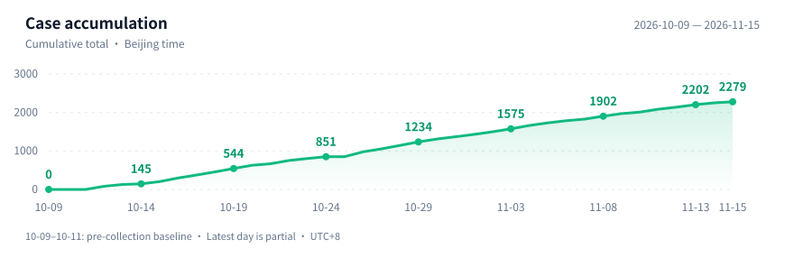

# Awesome REA Cases

**English (default)** | [简体中文](README.zh-CN.md)

### Explore software and hardware with AI.

A curated collection of **AI-assisted reverse-engineering projects, experiments, and ideas** for device interoperability, behavior-preserving app rebuilding and game preservation—including failed attempts and author corrections.

# 2678 cases & projects

**Latest case update:** November 23, 2026, 04:10 · **Last maintained:** November 23, 2026, 04:10 · Beijing time (UTC+8). Counts as of this maintenance; source dates and the continuous evidence cutoff are separate.

Updates **6× daily** · [Full index](INDEX.en.md) · [Browse categories](#browse-by-category)

Covers [REA](https://github.com/morluto/rea) and other AI-assisted work. REA connects coding agents to local reverse-engineering tools through CLI and MCP.

*Based on author and project reports; not independently reproduced here. Evidence and project status are recorded in each case.*

## Recent picks

**10 worth reading**: recover a compiler, preserve games, replay slow functions, or reconnect displays, keyboards and agent chats. The selection favors inspectable comparisons and clear limits over promised ports or unmeasured speedups. Dates identify sources or author updates, not collection dates.

1. **[borland-reborn: recover a 1991 compiler](cases/en/borland-reborn-bcc20-exhume-byte-matching.md)** · `2026-11-14` report and pinned docs — Exhume's Claude Code skills support **reportedly byte-identical BCC.EXE/CPP.EXE rebuilds**. A separate modding build has 1,836 compile comparisons and 83% coverage, not every path or uniquely recovered original source. Not rebuilt here. `Unverified here`
2. **[OpenGlass Go: reopen a glasses-free 3D display](cases/en/openglass-go-kimi-gemini-armbian-firmware.md)** · `2026-11-22` author thread and pinned builder docs — Megabits credits **Kimi for reversing and early code, Gemini Neon for finishing Armbian firmware**. Public docs describe 3D media playback, file transfer and STM32 control. Hardware testing is project-reported; the kernel bug awaits submission. Not built or flashed here. `In progress`
3. **[Darmoshark TOP75: keyboard control on Mac](cases/en/darmoshark-top75-macos-ai-protocol-report.md)** · `2026-11-18` author reply and pinned docs — **AI-assisted Windows-utility research plus IOKit checks** support RGB, remapping, macros and lights-off scheduling over Bluetooth. Project docs record readback, rollback and failed writes; display uploads use USB and on-device GIF playback remains unvalidated. Not tested here. `Unverified here`
4. **[Horizon: Minecraft Java behavior, rebuilt in Rust](cases/en/horizon-minecraft-java-rust-ai-differential-reimplementation.md)** · `2026-11-16` report and pinned docs — **AI-assisted reconstruction with 281 reported differential harnesses**, existing saves and vanilla multiplayer. Public docs and a Codex-credited commit were read, not the full test results; performance claims are hardware-specific. Own game required; not built here. `In progress`
5. **[Underworld Exhumed: preserve two DOS worlds](cases/en/underworld-exhumed-ultima-claude-skills-byte-matching.md)** · `2026-11-20` introduction; `2026-11-17` pinned docs — Exhume's Claude Code skills support **reported byte-identical UW.EXE/UW2.EXE rebuilds**, plus native/web ports checked against 17/13 DOS recordings. Project reports, not checks rerun here; native ports need your own game data. `Unverified here`
6. **[fast-anything: rebuild only the slow functions](cases/en/fast-anything-ai-hot-function-rust-replay-project.md)** · `2026-11-22` report and pinned docs — Claude/Codex port hotspots to Rust against **up to 500 recorded calls plus derived tests**. A 700-name Python dedupe example reportedly goes from 4.91 s to 42 ms, not a universal 116× gain. Float tolerance and finite inputs limit equivalence; recording runs the original. Not benchmarked here. `Related project`
7. **[rust-anything: rebuild Prettier without guessing its output](cases/en/rust-anything-claude-behavior-capture-rust-migration.md)** · `2026-11-22` report and pinned docs — Agents write Rust against recorded behavior. Updated project docs report **17,224 byte-identical runs, 15,861 fully in Rust**; the rest fall back. The earlier M4 benchmark's roughly 19× CLI gain includes process startup, versus 4.2× warmed in-process. Recording runs real side effects; use isolated copies. Not rerun here. `Unverified here`
8. **[CPS-2 Recomp: arcade games, with timing checked](cases/en/cps2recomp-claude-native-arcade-recompilation.md)** · `2026-11-20` report and pinned docs — **Claude-credited work on native C++ ports** adds board waits and DMA timing alongside training and rollback play. SFA2 reportedly matches reference work RAM on **5,634/5,671 frames**, with an eleven-frame offset; another game diverges. The reference is a model, not hardware, and the harness is not public. Own ROMs required; not run here. `In progress`
9. **[Consessus: let existing agent chats talk](cases/en/consessus-rea-mac-agent-app-interoperability.md)** · `2026-11-21` author thread and pinned docs — **REA-assisted research into four Mac apps' local channels** yields a session-messaging CLI. Project docs report round trips and four-task/four-answer rooms on one Mac; OpenCode desktop needs an in-session listener, and some paths remain fake-only tests. Undocumented interfaces can break; not run here. `In progress`
10. **[OpenSpindrift: Saturn Sonic 3D Blast, native on PC](cases/en/sonic-3d-blast-saturn-opus-port.md)** · `2026-11-21` author announcement and reply thread — Mr. Matt announces **a first release for Windows, Linux and Android** from AI-assisted decompilation. David24 describes manual review and fixes, not autonomous completion. Source cleanup and CI were pending at announcement; own Saturn CHD required, release not tested here. `In progress`

## Classic cases

- **[Universal Modder](cases/en/universal-modder.md)** — AI-assisted cross-game mods, including Minecraft content in GTA V.
- **[Firefighter](cases/en/firefighter-rust.md)** — Recover Pascal logic from a DOS binary, then rewrite it in Rust, according to the author.
- **[Modern Warfare 2](cases/en/mw2-decompilation.md)** — Author-reported multi-agent reconstruction; **83% function byte matches**, no public code or independent reproduction here.
- **[Smart toilet from the Mac menu bar](cases/en/smart-toilet.md)** — Author-reported Bluetooth research and home-device control.
- **[Apple TV remote on Linux](cases/en/siri-remote-linux.md)** — Bluetooth interoperability with a public implementation; REA use unconfirmed.
- **[Plustek scanner & ThinkPad camera](cases/en/schaller-opticfilm-thinkpad-linux.md)** — Windows reference behavior informs Linux drivers; published measurements retain low-light and exposure defects.
- **[Fireface UCX on Linux](cases/en/johan-fireface-ucx-linux-rea-claude-driver.md)** — Johan reports REA/Claude driver work, a terminal mixer and **3.5 ms round-trip audio at 48 kHz** on one first-generation unit; not reproduced here.
- **[LG PlxNative](cases/en/lg-plxnative.md)** — Native Plex client; user-selection time reportedly falls from **30 seconds to 3 seconds**.

## Browse by category

| Category | Entries |
| :--- | ---: |
| [Games & preservation](categories/en/games.md) | **523** |
| [Hardware & interoperability](categories/en/hardware.md) | **704** |
| [Applications & clients](categories/en/apps.md) | **1110** |
| [Algorithms & feature recovery](categories/en/algorithms.md) | **341** |

[**View all cases →**](INDEX.en.md) · [Contribute (中文)](CONTRIBUTING.md) · [Maintenance (中文)](MAINTENANCE.md)

<strong>Update & evidence notes</strong>

- **Continuous resolved-material cutoff:** October 15, 2026, 16:00, Beijing time. Older unresolved sources can hold this cutoff back while newer entries are added; it is not a verification date for every project.
- Searches run six times daily with keyword and pagination limits; coverage is bounded, not exhaustive, and some linked evidence remains unresolved. Source dates, evidence boundaries, and engagement snapshots are recorded in case details.
- Full descriptions, sources, and language switching are available on every case page.

## Scope & license

**Unofficial collection.** Original summaries and public links only; no proprietary software, game assets, keys, or private material.

Original curation and code: **[MIT](LICENSE)**. Linked work retains its own rights; use legally obtained targets and check the relevant permissions.
