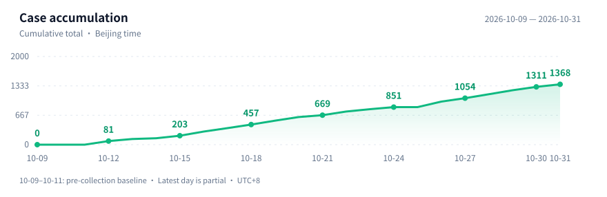

# Awesome REA Cases

**English (default)** | [简体中文](README.zh-CN.md)

### Explore software and hardware with AI.

A curated collection of **reverse-engineering projects, experiments, and ideas**: revive old devices, rebuild apps, preserve games, and understand hidden behavior.

# 1311 cases & projects

**Latest case update:** October 30, 2026, 20:13 · **Last maintained:** October 30, 2026, 20:13 · Beijing time (UTC+8). Counts as of this maintenance.

Updates **6× daily** · [Full index](INDEX.en.md) · [Browse categories](#browse-by-category)

Covers [REA](https://github.com/morluto/rea) and other AI-assisted work. REA connects coding agents to local reverse-engineering tools through CLI and MCP.

*Based on author and project reports; not independently reproduced here. Evidence and project status are recorded in each case.*

## Recent picks

**10 worth reading** for device interoperability, useful replacements and game preservation. Prefer inspectable implementations and explicit test limits over claims of complete reconstruction. Dates below are source or author-update dates, not collection dates.

1. **[tolpo: a live 3D view of your Tapo home](cases/en/tolpo-tapo-claude-lan-3d-home-report.md)** · `2026-10-29` — A Claude-assisted protocol-research report leads to **public LAN/MCP control and a human-corrected floor plan**. Reuses python-kasa; earlier project tests cover nine rooms and 18 devices, not every write or model. Local device traffic does not mean local AI. `In progress`
2. **[hexgrab: learn from PowerToys, then build a smaller picker](cases/en/hexgrab-powertoys-colorpicker-rea-study.md)** · `2026-10-29` report; `2026-10-12` investigation — Claude/REA studies shipped binaries; the author's source scorecard gives **8 of 9 claims fully correct, one partial**. Public .NET 10 implementation; hotkey registration in an unexamined runner exposed a blind spot. One monitor tested, not independently rerun. `Analysis test`
3. **[scapectl: control a Fractal Scape headset without the web app](cases/en/scapectl-fractal-scape-claude-usb-hid.md)** · `2026-10-29` — **Claude Code-assisted USB HID research and a public Go tray app/CLI** for status, EQ presets and device events. Documents hardware corrections to source labels; macOS/Windows project-tested, Linux untested. Unsigned/unnotarized; not run here. `In progress`
4. **[Where NIST curve seeds came from](cases/en/nist-ecdsa-origin-claude-report.md)** · `2026-10-16` — Anthropic reports Claude traced public parameters to **lrand48 and timestamps**, publishing code and unresolved questions. **Not an ECDSA break**; not independently recomputed here. `Research report`
5. **[LG UltraFine: repair the updater, not the firmware](cases/en/lg-ultrafine-codex-updater-patch.md)** · `2026-10-19` — Codex-assisted diagnosis and a **public, exact-build memory patch**; the author reports a scaler update reaching **100% with CRC passing**. Credits an earlier bug report; one Apple Silicon setup, not independently flashed here. `Author-tested patch`
6. **[Brother: scan straight to your NAS](cases/en/brother-scan-button-claude-rea-server.md)** · `2026-10-18` — Replace the PC button app with a **public Claude/REA-assisted Go service for SMB, FTP, S3 and local storage**, building on prior protocol work. A server is still required; only MFC-L2800DW firmware 1.32 is project-tested. `Public implementation`
7. **[Claude writes proofs; Rocq checks the binaries](cases/en/anthropic-theorem-claude-binary-formal-verification.md)** · `2026-10-22` — Anthropic/Theorem report machine-code no-crash proofs for **239 entry points across 123 libraries**. Single-threaded static RISC-V/Linux, inputs below 64MB; **not bug-free whole libraries**, and the checker was not independently rerun here. `Analysis test`
8. **[Moon-Buggy: recover the rules, then build a browser game](cases/en/it-connect-moon-buggy-rea-claude-web-rebuild.md)** · `2026-10-29` article — Florian BURNEL reports **REA/Claude/Ghidra analysis of a stripped Linux binary and playable HTML in 12m29s**. Public-source teaching target; the author checks jump timing and scoring but catches a naming error. Full address report and game not independently tested here. `Analysis test`
9. **[TabStationToo: PS2 games in a browser tab](cases/en/tabstationtoo-pcsx2-claude-web-port-report.md)** · `2026-10-30` report and project commit (Beijing time) — **PCSX2 adapted to WebAssembly JITs and WebGPU**, with Claude credited in a commit. Project reports near-full speed in selected scenes, not every game; bring your own BIOS and games. No phones, no independent gameplay test here. `Experimental`
10. **[PicasaPy: keep a local photo workflow alive](cases/en/picasapy-ghidra-claude-codex-photo-manager.md)** · `2026-10-28` (Beijing time) — Virág Attila's **Ghidra/Claude/Codex-assisted Python/Qt rewrite** has public research specifications and successful exact-commit CI. Shared **.picasa.ini** files are not conflict-safe synchronization; project documents separate static coverage from click tests. Full parity not established; not run here. `In progress`

## Classic cases

- **[Universal Modder](cases/en/universal-modder.md)** — AI-assisted cross-game mods, including Minecraft content in GTA V.
- **[Firefighter](cases/en/firefighter-rust.md)** — Recover Pascal logic from a DOS binary, then rewrite it in Rust, according to the author.
- **[Modern Warfare 2](cases/en/mw2-decompilation.md)** — Author-reported multi-agent reconstruction; **83% function byte matches**, no public code or independent reproduction here.
- **[Smart toilet from the Mac menu bar](cases/en/smart-toilet.md)** — Author-reported Bluetooth research and home-device control.
- **[Apple TV remote on Linux](cases/en/siri-remote-linux.md)** — Bluetooth interoperability with a public implementation; REA use unconfirmed.
- **[Plustek scanner & ThinkPad camera](cases/en/schaller-opticfilm-thinkpad-linux.md)** — Windows reference behavior informs Linux drivers; published measurements retain low-light and exposure defects.
- **[LG PlxNative](cases/en/lg-plxnative.md)** — Native Plex client; user-selection time reportedly falls from **30 seconds to 3 seconds**.

## Browse by category

| Category | Entries |
| :--- | ---: |
| [Games & preservation](categories/en/games.md) | **273** |
| [Hardware & interoperability](categories/en/hardware.md) | **355** |
| [Applications & clients](categories/en/apps.md) | **547** |
| [Algorithms & feature recovery](categories/en/algorithms.md) | **136** |

[**View all cases →**](INDEX.en.md) · [Contribute (中文)](CONTRIBUTING.md) · [Maintenance (中文)](MAINTENANCE.md)

<strong>Update & evidence notes</strong>

- **Continuous resolved-material cutoff:** October 15, 2026, 16:00, Beijing time. Older unresolved sources can hold this cutoff back while newer entries are added; it is not a verification date for every project.
- Searches run six times daily with keyword and pagination limits; coverage is bounded, not exhaustive, and some linked evidence remains unresolved. Source dates, evidence boundaries, and engagement snapshots are recorded in case details.
- Full descriptions, sources, and language switching are available on every case page.

## Scope & license

**Unofficial collection.** Original summaries and public links only; no proprietary software, game assets, keys, or private material.

Original curation and code: **[MIT](LICENSE)**. Linked work retains its own rights; use legally obtained targets and check the relevant permissions.
