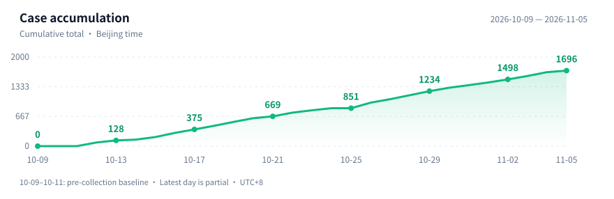

# Awesome REA Cases

**English (default)** | [简体中文](README.zh-CN.md)

### Explore software and hardware with AI.

A curated collection of **AI-assisted reverse-engineering projects, experiments, and ideas** for device interoperability, app rebuilding and game preservation—including failed attempts and author corrections.

# 2114 cases & projects

**Latest case update:** November 12, 2026, 08:10 · **Last maintained:** November 12, 2026, 08:10 · Beijing time (UTC+8). Counts as of this maintenance; source dates and the continuous evidence cutoff are separate.

Updates **6× daily** · [Full index](INDEX.en.md) · [Browse categories](#browse-by-category)

Covers [REA](https://github.com/morluto/rea) and other AI-assisted work. REA connects coding agents to local reverse-engineering tools through CLI and MCP.

*Based on author and project reports; not independently reproduced here. Evidence and project status are recorded in each case.*

## Recent picks

**10 worth reading**: bring camera photos straight to a Mac, check your own app before release, and preserve games. Concrete uses sit alongside small tests and documented limitations. Dates identify sources or author updates, not collection dates.

1. **[Fujifilm X half: camera to Mac without the phone](cases/en/fujifilm-x-half-opus-wireless-mac-import-report.md)** · `2026-11-12` author report — **Opus reportedly finds Bluetooth time-slot and Wi-Fi startup-code differences**, then builds JPEG imports and Google Photos uploads. sneha describes incremental tests on their camera, not an iteration-free build. Code and protocol traces unchecked here. `Unverified here`
2. **[Tiny Electron app: correct wiring, oversized evidence](cases/en/rea-tiny-electron-ipc-evidence-output-test.md)** · `2026-11-11` author test — **REA reportedly pairs renderer-to-main IPC in a five-file, 846-byte sample**, but emits 316kb of JSON and skips an inline script. Roughly ten seconds includes cold startup; no source or full output checked here. `Analysis test`
3. **[hexgrab: learn from PowerToys, then build a smaller picker](cases/en/hexgrab-powertoys-colorpicker-rea-study.md)** · `2026-10-29` report; `2026-10-12` investigation — Claude/REA studies shipped binaries; the author's source scorecard gives **8 of 9 claims fully correct, one partial**. Public .NET 10 implementation; hotkey registration in an unexamined runner exposed a blind spot. One monitor tested, not independently rerun. `Analysis test`
4. **[REA on your own app: exposure checks before release](cases/en/phosphen-rea69-own-app-exposure-gate-test.md)** · `2026-11-12` author test — **Phosphen reports finding full source in a source map and a Stripe key in a test app**, plus a high-exposure release gate returning 3 before fixes and 0 afterward. Reported 6.9-branch build; sample, video and logs unchecked here. Not evidence that every key is usable or every finding is a leak. `Analysis test`
5. **[MousePods: AirPods become a Linux mouse and head tracker](cases/en/airpods3-claude-remotehid-linux-head-mouse-report.md)** · `2026-11-11` reports; `2026-11-10` pinned project docs — **Claude-assisted RemoteHID research, a public implementation and project-reported AirPods 3/Pro 2 hardware checks.** No earbud flashing; Proton game integration does modify prefixes. MTU and device-identity changes were not isolated; some modes remain experimental. Not run here. `Unverified here`
6. **[A 1994 Jeep: check the firmware before trusting the number](cases/en/zulali-32year-jeep-claude-control-report.md)** · `2026-11-11` author and reader reports — **Claude/Codex-assisted SCI diagnostics and a reported fuel-trim sign correction.** fly relays NOx falling from 702 to 13, but the final modification is unclear. Passing inspection is not proof of compliance; actuator commands are not autonomous driving. Repository and vehicle tests unchecked here. `Unverified here`
7. **[TimeSplitters 2: trace PS2 behavior into a native PC port](cases/en/destinity-timesplitters2-claude-native-pc-recompile.md)** · `2026-11-10` author report; `2026-11-09` pinned docs — **Claude-assisted MIPS-to-C++ work, with PCSX2 frame and state comparisons.** The project reports a Linux/Steam Deck first-level playthrough, still using PCSX2 graphics/audio. Internal test tooling is unpublished; later levels, some VU1 state and internet play need checks. Windows/online await release. Bring your own disc; not built here. `In progress`
8. **[bo2-mac: Black Ops II on ARM64](cases/en/bo2-mac-claude-arm64-static-translation-report.md)** · `2026-11-11` thread report — **Claude-assisted Ghidra/Remill/LLVM translation, reportedly 51–60fps in campaign on one M1.** Some code still uses a tiny x86 VM; beta, no online, reported 111–116°C. Repository and test logs unchecked; bring your own Steam copy. `Unverified report`
9. **[DX-Ball: from one audio function to a Windows rebuild](cases/en/dx-ball-sound-pan.md)** · `2026-11-01` report; `2026-10-31` project record — Codex/REA/Ghidra reconstruction reports **270 matching game functions and 84,968 bytes**, plus a native VC4 build. Timestamp-only image differences are against an earlier rebuild, not the retail EXE. Original 50-board campaign and full native audio remain unverified; bring your own files. Not rebuilt here. `Project-tested reconstruction`
10. **[Nichicon battery: acknowledgment is not execution](cases/en/gemini-echonet-lite-code-copy-analysis-report.md)** · `2026-11-11` author article, recalling August–September work — **Gemini-assisted HEX comparisons identify reported power and schedule fields.** The author also records unchanged settings despite success replies, standby deadlock and copy-paste fixes losing safeguards. Hardware safety and long-term operation are not verified here. `In progress`

## Classic cases

- **[Universal Modder](cases/en/universal-modder.md)** — AI-assisted cross-game mods, including Minecraft content in GTA V.
- **[Firefighter](cases/en/firefighter-rust.md)** — Recover Pascal logic from a DOS binary, then rewrite it in Rust, according to the author.
- **[Modern Warfare 2](cases/en/mw2-decompilation.md)** — Author-reported multi-agent reconstruction; **83% function byte matches**, no public code or independent reproduction here.
- **[Smart toilet from the Mac menu bar](cases/en/smart-toilet.md)** — Author-reported Bluetooth research and home-device control.
- **[Apple TV remote on Linux](cases/en/siri-remote-linux.md)** — Bluetooth interoperability with a public implementation; REA use unconfirmed.
- **[Plustek scanner & ThinkPad camera](cases/en/schaller-opticfilm-thinkpad-linux.md)** — Windows reference behavior informs Linux drivers; published measurements retain low-light and exposure defects.
- **[LG PlxNative](cases/en/lg-plxnative.md)** — Native Plex client; user-selection time reportedly falls from **30 seconds to 3 seconds**.

## Browse by category

| Category | Entries |
| :--- | ---: |
| [Games & preservation](categories/en/games.md) | **428** |
| [Hardware & interoperability](categories/en/hardware.md) | **568** |
| [Applications & clients](categories/en/apps.md) | **866** |
| [Algorithms & feature recovery](categories/en/algorithms.md) | **252** |

[**View all cases →**](INDEX.en.md) · [Contribute (中文)](CONTRIBUTING.md) · [Maintenance (中文)](MAINTENANCE.md)

<strong>Update & evidence notes</strong>

- **Continuous resolved-material cutoff:** October 15, 2026, 16:00, Beijing time. Older unresolved sources can hold this cutoff back while newer entries are added; it is not a verification date for every project.
- Searches run six times daily with keyword and pagination limits; coverage is bounded, not exhaustive, and some linked evidence remains unresolved. Source dates, evidence boundaries, and engagement snapshots are recorded in case details.
- Full descriptions, sources, and language switching are available on every case page.

## Scope & license

**Unofficial collection.** Original summaries and public links only; no proprietary software, game assets, keys, or private material.

Original curation and code: **[MIT](LICENSE)**. Linked work retains its own rights; use legally obtained targets and check the relevant permissions.
