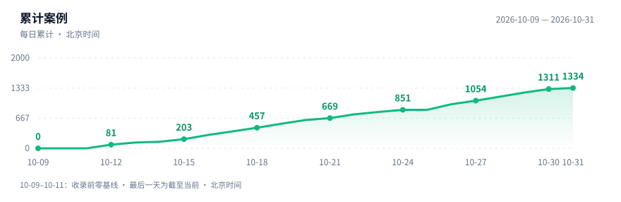

# Awesome REA Cases

[English](README.md) | **简体中文**

### 用 AI 读懂软件与硬件。

精选 **AI 逆向的项目、实验与具体想法**：让旧设备继续工作，重建应用功能，保存游戏，理解隐藏的实现。

# 1384 个案例与项目

**最近案例更新：**2026 年 11 月 1 日 00:16 · **最近维护：**2026 年 11 月 1 日 00:16 · 北京时间（UTC+8）；数量统计截至此次维护。

**每天更新 6 次** · [完整目录](INDEX.md) · [按分类浏览](#分类浏览)

覆盖 [REA](https://github.com/morluto/rea) 与其他 AI 辅助逆向。REA 通过 CLI / MCP，让编程 Agent 调用本地逆向工具。

*据作者与项目报告整理，未经本合集独立复现；证据与项目状态见各案例详情。*

## 近期精选

**10 个值得读的案例**，从设备互通、实用替代品到游戏保存与二进制分析：优先看可检查的实现与明确测试边界，广泛传播的说法本身并不证明替代品已可用。下列日期为来源或作者更新日期，不是收录日期。

1. **[tolpo：Tapo住宅的实时3D视图](cases/tolpo-tapo-claude-lan-3d-home-report.md)** · `2026-10-29` — 转述Claude辅助协议研究，公开**LAN/MCP控制与人工校正户型**。复用python-kasa；较早项目自测覆盖九房间、18设备，不代表所有写操作与型号。设备本地通信不等于AI本地运行。`进行中`
2. **[hexgrab：研究PowerToys，再做小取色器](cases/hexgrab-powertoys-colorpicker-rea-study.md)** · `2026-10-29`报道；`2026-10-12`研究 — Claude/REA调查发布二进制，作者对照源码得出**九项中八项完全正确、一项部分正确**。公开.NET10实现；未分析的runner负责注册热键，暴露跨二进制盲点。只测单屏，本合集未重跑。`分析测试`
3. **[scapectl：不用网页也能控制Fractal Scape耳机](cases/scapectl-fractal-scape-claude-usb-hid.md)** · `2026-10-29` — **Claude Code辅助USB HID研究，公开Go托盘应用与CLI**，查看状态、切EQ预设、响应设备事件。文档保留实机纠正源码标注的过程；项目只测macOS/Windows，Linux未测。未经签名／公证，本合集未运行。`进行中`
4. **[NIST 曲线种子从哪来](cases/nist-ecdsa-origin-claude-report.md)** · `2026-10-16` — Anthropic 报告 Claude 追到 **lrand48 与时间戳**，公开代码，也保留未解问题。**不是破解 ECDSA**，本合集未独立复算。`研究报告`
5. **[LG UltraFine：修更新器，而不是破解固件](cases/lg-ultrafine-codex-updater-patch.md)** · `2026-10-19` — Codex 辅助诊断，公开**精确构建限定的内存补丁**；作者报告 scaler 更新达 **100%、CRC 通过**。注明前人错误报告；仅一套 Apple Silicon 配置，本合集未独立刷机。`作者实测补丁`
6. **[Brother：扫描直接进 NAS](cases/brother-scan-button-claude-rea-server.md)** · `2026-10-18` — 以 **Claude/REA 辅助的公开 Go 服务替代电脑按键应用，支持 SMB、FTP、S3 与本地保存**，复用前人协议研究。仍需服务器；项目只报告测试 MFC-L2800DW 固件1.32。`公开实现`
7. **[Claude 写证明，Rocq 检查二进制](cases/anthropic-theorem-claude-binary-formal-verification.md)** · `2026-10-22` — Anthropic／Theorem 报告为 **123 库的 239 个入口**建立机器码无崩溃证明。限单线程静态 RISC-V/Linux、小于64MB输入；**不等于整库无 bug**，本合集未独立重跑检查器。`分析测试`
8. **[OKOK Libre：留下体脂秤，换掉广告App](cases/okok-libre-rea-glm-scale-android.md)** · `2026-10-31` — JYunth称REA／GLM研究APK、Opus制作UI，**公开Android代码覆盖三种OKOK蓝牙协议**。固定主Manifest无联网权限，不等于最终APK审计；部分秤家族未支持，公式等价与健康估计未核验。`进行中`
9. **[X战警2：从Genesis到四人PC合作](cases/xmen2-pc-claude-genesis-native-port.md)** · `2026-10-31`报道；`2026-10-28`项目文档 — crabsmack称Claude Code辅助Windows／Linux原生移植，报告**3047个C函数字节匹配**，另117个汇编函数做指令级对照。新增回滚联机与宽屏；四人模式测试较少。须自备ROM，本合集未重跑。`公开实现`
10. **[牧场物语：可读的C，也能直接玩](cases/rodoly-harvest-moon-snes-ai-native-report.md)** · `2026-10-31`报道；`2026-10-30`项目文档 — RodoLy披露**人工监督AI**，报告比较内存与寄存器、验证**778例程／45176指令**。原生C beta可选宽屏与无限经营，画面／声音芯片仍软件实现。须自备USA ROM并本机构建；本合集未重跑校验。`分析测试`

## 经典案例

- **[Universal Modder](cases/universal-modder.md)** — AI 辅助跨游戏 Mod，把 Minecraft 内容放进 GTA V 等游戏。
- **[Firefighter：DOS 二进制到 Rust](cases/firefighter-rust.md)** — 作者报告先恢复 Pascal 逻辑，再转写为 Rust。
- **[《现代战争 2》](cases/mw2-decompilation.md)** — 作者报告多 Agent 重建，**83% 函数字节级匹配**；代码未公开，未独立复现。
- **[Mac 菜单栏控制智能马桶](cases/smart-toilet.md)** — 作者报告研究蓝牙通信，并扩展到其他家居设备。
- **[Apple TV 遥控器接入 Linux](cases/siri-remote-linux.md)** — 蓝牙互通与公开实现，未确认使用 REA。
- **[Plustek 扫描仪与 ThinkPad 相机](cases/schaller-opticfilm-thinkpad-linux.md)** — 用Windows参考行为改善Linux驱动，公开测量仍保留低光与曝光缺陷。
- **[LG PlxNative](cases/lg-plxnative.md)** — 原生 Plex 客户端；作者报告用户选择时间从 **30 秒降到 3 秒**。

## 分类浏览

| 分类 | 数量 |
| :--- | ---: |
| [游戏与游戏保存](categories/games.md) | **295** |
| [硬件与设备互通](categories/hardware.md) | **370** |
| [应用与客户端](categories/apps.md) | **571** |
| [算法与功能重建](categories/algorithms.md) | **148** |

[**查看全部案例 →**](INDEX.md) · [贡献案例](CONTRIBUTING.md) · [维护方法](MAINTENANCE.md)

<strong>更新时间与证据说明</strong>

- **连续已解决材料的证据截止：**2026 年 10 月 15 日 16:00，北京时间。往期未解决来源会使截止时间暂缓，较新的案例仍可收录；这不是每个项目的验证日期。
- 每天检索 6 次，受关键词和分页限制，属于有界覆盖，不代表全网全量，部分链接证据仍待核实。来源日期、证据边界与热度快照见各案例详情。
- 每个案例均提供完整介绍、公开来源及中英文切换。

## 范围与许可

**非 REA 官方项目。**只整理原创摘要与公开链接，不分发原软件、游戏资产、密钥或私人材料。

原创整理与代码采用 **[MIT](LICENSE)**。链接内容保留各自权利；研究和复现请使用合法取得的目标，并确认相应授权。
