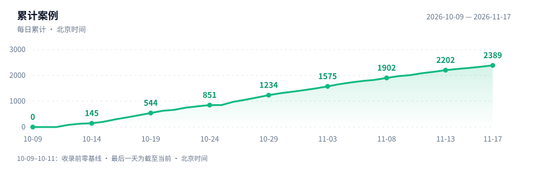

# Awesome REA Cases

[English](README.md) | **简体中文**

### 用 AI 读懂软件与硬件。

精选 **AI 辅助逆向的项目、实验与具体想法**：让设备互通，保留旧行为重建应用，保存游戏，也记录失败尝试与作者对旧结论的更正。

# 2725 个案例与项目

**最近案例更新：**2026 年 11 月 24 日 08:01 · **最近维护：**2026 年 11 月 24 日 08:01 · 北京时间（UTC+8）；数量统计截至此次维护，来源日期与连续证据截止另行标明。

**每天更新 6 次** · [完整目录](INDEX.md) · [按分类浏览](#分类浏览)

覆盖 [REA](https://github.com/morluto/rea) 与其他 AI 辅助逆向。REA 通过 CLI / MCP，让编程 Agent 调用本地逆向工具。

*据作者与项目报告整理，未经本合集独立复现；证据与项目状态见各案例详情。*

## 近期精选

**10 个值得读的案例**：恢复编译器、保存游戏、调查拖车制动、连通Agent会话，或让闲置多年的LED招牌重新亮起。优先看有文档的具体对照与坦诚保留的缺口，不追逐包办一切的宣称。下列日期为来源或作者更新日期，不是收录日期。

1. **[borland-reborn：重建1991年的编译器](cases/borland-reborn-bcc20-exhume-byte-matching.md)** · `2026-11-14`介绍与固定文档 — Exhume的Claude Code skills辅助，项目报告**BCC.EXE／CPP.EXE整文件字节一致**。另有改版构建的1836次编译对照、83%覆盖，不代表所有路径或唯一原始源码。本合集未重建。`未独立核验`
2. **[OpenGlass Go：重新开放裸眼3D屏](cases/openglass-go-kimi-gemini-armbian-firmware.md)** · `2026-11-22`作者串与固定构建文档 — Megabits将**逆向和初期代码归功Kimi，Armbian固件收尾归功Gemini Neon**。公开文档列3D媒体播放、文件传输与STM32控制；真机测试为项目自报，内核bug仍待提交。本合集未构建或刷写。`进行中`
3. **[Darmoshark TOP75：在Mac控制键盘](cases/darmoshark-top75-macos-ai-protocol-report.md)** · `2026-11-18`作者回复与固定文档 — **AI辅助研究Windows工具，再用IOKit实机检查**，支持蓝牙RGB、改键、宏与定时熄灯。项目文档记录读回、回退和丢写；显示上传走USB，GIF机上播放仍待验证。本合集未测试。`未独立核验`
4. **[Horizon：用Rust重建Minecraft Java行为](cases/horizon-minecraft-java-rust-ai-differential-reimplementation.md)** · `2026-11-16`介绍与固定文档 — **AI辅助重建，自报281套差分测试**，可读旧存档、连原版服务器。已读公开文档与Codex署名提交，未审完整测试结果；性能宣称有硬件条件。自备游戏，本合集未构建。`进行中`
5. **[Underworld Exhumed：保存两部DOS地下世界](cases/underworld-exhumed-ultima-claude-skills-byte-matching.md)** · `2026-11-20`介绍；`2026-11-17`固定文档 — Exhume的Claude Code技能辅助，项目报告**UW.EXE／UW2.EXE整文件字节一致**，原生与Web移植以17／13段DOS录制回放检查。均为项目报告，本合集未重跑；原生版自备游戏数据。`未独立核验`
6. **[Elecbrakes：研究拖车的蓝牙刹车](cases/elecbrakes-claude-android-brake-audit-report.md)** · `2026-11-19`研究者原文；`2026-11-20`CVE登记 — Forck与McCarthy用**Claude读字节码、做研究工具**，再报告自有硬件测试。EB2／VM1修复有文档，旧ELBC 2000截至原文无修复；固件静态分析没有证明恶意刷写。本合集未复现。`未独立核验`
7. **[rust-anything：重建Prettier，不猜输出](cases/rust-anything-claude-behavior-capture-rust-migration.md)** · `2026-11-22`介绍与固定文档 — Agent按录制行为写Rust，新文档报告**17224次字节一致，15861次全在Rust**，其余回退。此前M4基准中CLI约19倍含进程启动优势，预热进程内为4.2倍。录制会真实执行副作用，须用隔离副本；本合集未重跑。`未独立核验`
8. **[CPS-2 Recomp：原生街机，还要对照时序](cases/cps2recomp-claude-native-arcade-recompilation.md)** · `2026-11-20`介绍与固定文档 — **Claude署名参与C++原生移植**，在训练和回滚联机之外补板级等待与DMA时序。项目报告SFA2工作RAM **5634／5671帧匹配参考**，仍有11帧偏移，另一游戏会分歧；参考是模型而非实机，harness尚未公开。自备ROM，本合集未运行。`进行中`
9. **[Consessus：让已有Agent聊天互通](cases/consessus-rea-mac-agent-app-interoperability.md)** · `2026-11-21`作者串与固定文档 — **REA研究四款Mac应用的本机通信**，做成会话消息CLI。项目报告单台Mac往返与四任务四回答的房间测试；OpenCode桌面版须在会话内开listener，部分路径只测假对象。未文档化接口可能随升级失效，本合集未运行。`进行中`
10. **[LightLink：让1998年的LED招牌重新亮起](cases/larry-pesce-lightlink-1998-claude-controller-revival.md)** · `2026-11-23`第一方原文 — Larry Pesce报告**Claude读旧PIC固件与Eagle电路图还原面板引脚**，再写ESP8266替换固件。他纠正一根错接跳线后报告面包板实机正常；原网络协议是绕开而非破解。新PCB仅通过DRC，尚未制造。本合集未复现。`未独立核验`

## 经典案例

- **[Universal Modder](cases/universal-modder.md)** — AI 辅助跨游戏 Mod，把 Minecraft 内容放进 GTA V 等游戏。
- **[Firefighter：DOS 二进制到 Rust](cases/firefighter-rust.md)** — 作者报告先恢复 Pascal 逻辑，再转写为 Rust。
- **[《现代战争 2》](cases/mw2-decompilation.md)** — 作者报告多 Agent 重建，**83% 函数字节级匹配**；代码未公开，未独立复现。
- **[Mac 菜单栏控制智能马桶](cases/smart-toilet.md)** — 作者报告研究蓝牙通信，并扩展到其他家居设备。
- **[Apple TV 遥控器接入 Linux](cases/siri-remote-linux.md)** — 蓝牙互通与公开实现，未确认使用 REA。
- **[Plustek 扫描仪与 ThinkPad 相机](cases/schaller-opticfilm-thinkpad-linux.md)** — 用Windows参考行为改善Linux驱动，公开测量仍保留低光与曝光缺陷。
- **[Fireface UCX接Linux](cases/johan-fireface-ucx-linux-rea-claude-driver.md)** — Johan报告REA／Claude研究驱动、终端混音器与**48kHz往返3.5ms**，仅一台第一代设备，本合集未复现。
- **[LG PlxNative](cases/lg-plxnative.md)** — 原生 Plex 客户端；作者报告用户选择时间从 **30 秒降到 3 秒**。

## 分类浏览

| 分类 | 数量 |
| :--- | ---: |
| [游戏与游戏保存](categories/games.md) | **531** |
| [硬件与设备互通](categories/hardware.md) | **718** |
| [应用与客户端](categories/apps.md) | **1129** |
| [算法与功能重建](categories/algorithms.md) | **347** |

[**查看全部案例 →**](INDEX.md) · [贡献案例](CONTRIBUTING.md) · [维护方法](MAINTENANCE.md)

<strong>更新时间与证据说明</strong>

- **连续已解决材料的证据截止：**2026 年 10 月 15 日 16:00，北京时间。往期未解决来源会使截止时间暂缓，较新的案例仍可收录；这不是每个项目的验证日期。
- 每天检索 6 次，受关键词和分页限制，属于有界覆盖，不代表全网全量，部分链接证据仍待核实。来源日期、证据边界与热度快照见各案例详情。
- 每个案例均提供完整介绍、公开来源及中英文切换。

## 范围与许可

**非 REA 官方项目。**只整理原创摘要与公开链接，不分发原软件、游戏资产、密钥或私人材料。

原创整理与代码采用 **[MIT](LICENSE)**。链接内容保留各自权利；研究和复现请使用合法取得的目标，并确认相应授权。
