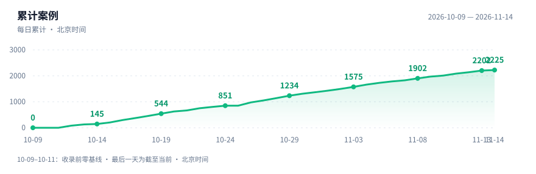

# Awesome REA Cases

[English](README.md) | **简体中文**

### 用 AI 读懂软件与硬件。

精选 **AI 辅助逆向的项目、实验与具体想法**：让设备互通，重建应用，保存游戏，也记录失败尝试与作者对旧结论的更正。

# 2130 个案例与项目

**最近案例更新：**2026 年 11 月 12 日 20:08 · **最近维护：**2026 年 11 月 12 日 20:08 · 北京时间（UTC+8）；数量统计截至此次维护，来源日期与连续证据截止另行标明。

**每天更新 6 次** · [完整目录](INDEX.md) · [按分类浏览](#分类浏览)

覆盖 [REA](https://github.com/morluto/rea) 与其他 AI 辅助逆向。REA 通过 CLI / MCP，让编程 Agent 调用本地逆向工具。

*据作者与项目报告整理，未经本合集独立复现；证据与项目状态见各案例详情。*

## 近期精选

**10 个值得读的案例**：让照片和录音进入自己的工作流，读懂不透明程序，核对钱包互通，也保存游戏。下列日期为来源或作者更新日期，不是收录日期。

1. **[富士X half：不用手机，照片直达Mac](cases/fujifilm-x-half-opus-wireless-mac-import-report.md)** · `2026-11-12`作者报告 — **Opus据报找到蓝牙时间槽与Wi-Fi启动码差异**，做出JPEG导入和Google Photos上传。sneha描述的是逐步实机试验，不是无迭代生成；本合集未审代码与协议抓包。`未独立核验`
2. **[Anker录音豆：让Agent找回上周的对话](cases/berryxia-anker-recorder-rea-mcp-knowledge-app.md)** · `2026-11-12`作者报告 — **Berryxia称用REA研究蓝牙协议，以MCP检索录音知识库**，可选千问本地ASR或在线转写。待调整UI、测试后再开源，本合集未核代码与设备链路。`进行中`
3. **[hexgrab：研究PowerToys，再做小取色器](cases/hexgrab-powertoys-colorpicker-rea-study.md)** · `2026-10-29`报道；`2026-10-12`研究 — Claude/REA调查发布二进制，作者对照源码得出**九项中八项完全正确、一项部分正确**。公开.NET10实现；未分析的runner负责注册热键，暴露跨二进制盲点。只测单屏，本合集未重跑。`分析测试`
4. **[REA检查自己的应用：发布前看暴露面](cases/phosphen-rea69-own-app-exposure-gate-test.md)** · `2026-11-12`作者自测 — **Phosphen称在测试应用的source map发现完整源码及Stripe键**，并报告高风险门禁修复前退出3、修复后0。自述使用6.9分支构建，本合集未审样本、视频与日志；不证明每个键可用或每项发现都是泄漏。`分析测试`
5. **[MousePods：AirPods在Linux当鼠标与游戏头追](cases/airpods3-claude-remotehid-linux-head-mouse-report.md)** · `2026-11-11`报道；`2026-11-10`固定项目文档 — **Claude辅助RemoteHID研究、公开实现与项目自报AirPods 3／Pro 2实机检查。**不刷耳机固件，但Proton游戏接入会改前缀。MTU与设备身份变化未隔离，部分模式仍实验。本合集未运行。`未独立核验`
6. **[NEAR Signer：让iPhone说Ledger协议](cases/near-signer-ios-ledger-ble-ai-report.md)** · `2026-11-12`报道与固定文档 — AI协作开发，项目自报**128个Swift、14个Python测试通过**，但BLE兼容只测模拟器；真实iPhone配对、相机与Xcode构建仍待项目验证。应用中加密保存的私钥不等同Ledger安全芯片，本合集未运行。`进行中`
7. **[TimeSplitters 2：把PS2行为追进原生PC版](cases/destinity-timesplitters2-claude-native-pc-recompile.md)** · `2026-11-10`作者报告；`2026-11-09`固定文档 — **Claude辅助MIPS到C++，以PCSX2画面与状态追查差异。**项目自报Linux／Steam Deck首关通关，仍用PCSX2图形／音频。内部测试工具未公开，后续关卡、部分VU1状态与互联网联机待测，Windows／在线版待发布。须自备光盘，本合集未构建。`进行中`
8. **[Shape：多年VM研究，整理成AI辅助Rust工具包](cases/bottingrocks-shape-security-rust-ai-toolkit.md)** · `2026-11-12`作者发布与固定文档 — **去混淆、追踪、请求信号编解码**共用CLI／SDK引擎。artifact须匹配构建与会话，运行时依赖可能令追踪停止，不支持的编辑会拒绝；数千seed回归仍为作者报告，本合集未重跑。`未独立核验`
9. **[DX-Ball：从声像函数走到Windows重建](cases/dx-ball-sound-pan.md)** · `2026-11-01`报道；`2026-10-31`项目记录 — Codex／REA／Ghidra重建报告**270个游戏函数、84968字节匹配**，另有原生VC4构建。仅时间戳不同的比较对象是较早重建版，不是原版EXE；原版50关通关与完整原生音频仍待测。须自备文件，本合集未重建。`项目自测重建`
10. **[GoGra Linux：AI和反编译器都要核](cases/gogra-linux-ghidra-opencode-six-errors-report.md)** · `2026-11-12`研究整理 — Ghidra／MCP／OpenCode调查据报梳理**四项反编译错误、两项AI误判**：漏调用与把build ID当API令牌，分别暴露不同层的失败。原研究、样本和脚本未审，不是通用错误率。`未核验转述`

## 经典案例

- **[Universal Modder](cases/universal-modder.md)** — AI 辅助跨游戏 Mod，把 Minecraft 内容放进 GTA V 等游戏。
- **[Firefighter：DOS 二进制到 Rust](cases/firefighter-rust.md)** — 作者报告先恢复 Pascal 逻辑，再转写为 Rust。
- **[《现代战争 2》](cases/mw2-decompilation.md)** — 作者报告多 Agent 重建，**83% 函数字节级匹配**；代码未公开，未独立复现。
- **[Mac 菜单栏控制智能马桶](cases/smart-toilet.md)** — 作者报告研究蓝牙通信，并扩展到其他家居设备。
- **[Apple TV 遥控器接入 Linux](cases/siri-remote-linux.md)** — 蓝牙互通与公开实现，未确认使用 REA。
- **[Plustek 扫描仪与 ThinkPad 相机](cases/schaller-opticfilm-thinkpad-linux.md)** — 用Windows参考行为改善Linux驱动，公开测量仍保留低光与曝光缺陷。
- **[LG PlxNative](cases/lg-plxnative.md)** — 原生 Plex 客户端；作者报告用户选择时间从 **30 秒降到 3 秒**。

## 分类浏览

| 分类 | 数量 |
| :--- | ---: |
| [游戏与游戏保存](categories/games.md) | **429** |
| [硬件与设备互通](categories/hardware.md) | **572** |
| [应用与客户端](categories/apps.md) | **874** |
| [算法与功能重建](categories/algorithms.md) | **255** |

[**查看全部案例 →**](INDEX.md) · [贡献案例](CONTRIBUTING.md) · [维护方法](MAINTENANCE.md)

<strong>更新时间与证据说明</strong>

- **连续已解决材料的证据截止：**2026 年 10 月 15 日 16:00，北京时间。往期未解决来源会使截止时间暂缓，较新的案例仍可收录；这不是每个项目的验证日期。
- 每天检索 6 次，受关键词和分页限制，属于有界覆盖，不代表全网全量，部分链接证据仍待核实。来源日期、证据边界与热度快照见各案例详情。
- 每个案例均提供完整介绍、公开来源及中英文切换。

## 范围与许可

**非 REA 官方项目。**只整理原创摘要与公开链接，不分发原软件、游戏资产、密钥或私人材料。

原创整理与代码采用 **[MIT](LICENSE)**。链接内容保留各自权利；研究和复现请使用合法取得的目标，并确认相应授权。
